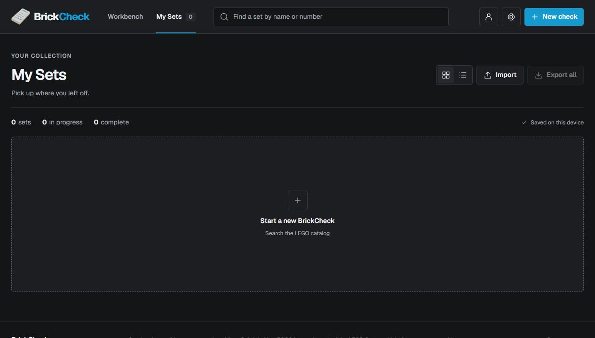

[](https://brickcheck.x-g.ca/)

# BrickCheck

> BrickCheck helps you recover complete LEGO sets from a mixed parts bin. Search the Rebrickable catalog, work through a pictured inventory, track multiple sets, and move progress between browsers with JSON import and export.

[](https://brickcheck.x-g.ca/)

[](https://brickcheck.x-g.ca/)

## Features

- Live Rebrickable search for sets, minifigures, polybags, and BrickHeadz
- Custom Rebrickable MOC checks from a MOC URL/ID and its exported inventory CSV
- Pictured part inventory with grid and list views
- Missing, found, minifigure, spare-part, color, and status organization
- Assembled or disassembled minifigure tracking
- Multiple locally saved set checks
- Optional username-and-password accounts that sync sets, progress, and the Rebrickable API key
- Per-set and all-set progress export/import
- Copy-ready BrickLink Wanted List XML for the exact missing quantities, including minifigure parts
- Responsive layout and dark mode
- Direct quantity editing: click the count, enter a total such as `12` or an adjustment such as `+5`, then press Enter or the check button
- Flexible inventory search: `tile 1x2`, `1 x 6`, `2x6 brick`, part numbers, and colors (words can appear in any order)

## Counting parts

Click a part card to add one, or use its minus/plus buttons. Click the middle count to edit:

- `12` sets the found total to 12.
- `+5` adds five to the current total.
- `-2` subtracts two.
- Enter or the check button saves; Escape or the cancel button cancels. Clicking away saves a valid entry.

Counts stay between zero and the quantity needed for that set. These controls also work on assembled minifigures and their individual components.

Part search ignores capitalization, spacing around dimensions, and word order. For example, `tile 1x2 black` matches a black “Tile 1 x 2 with Groove”, but not a 1 x 20 tile.


## Local development

Requires Node.js 22.13 or newer.

```bash
npm install
npm run dev
```

Open `http://localhost:3000/`.

To verify the static export:

```bash
npm run build
```

The publishable files are generated in `dist/client`.

To run the static app's TypeScript checks, automated regression tests, and production export together:

```bash
npm run verify
```

`npm test` runs the inventory, quantity-entry, search, import, image-positioning, and catalog-client tests without a network connection. `npm run typecheck` checks the static app, not the unused Cloudflare starter files in `db` and `worker`.

## GitHub Pages updates

Keep the existing GitHub Pages workflow, Supabase configuration, and secrets. Commit the source changes with GitHub Desktop and click **Push origin**; the existing workflow builds and publishes the updated app. Do not commit `node_modules`, `.env.local`, or `dist`.

The refinement retains the existing JSON save format and browser storage keys. It adds memory-only catalog caching, cancellation of superseded searches, memoized part cards, batched local saves, sequential cloud writes, and keyboard-contained dialogs. Back up your collection with **Export all** before any update. Cloud sync remains snapshot-based; avoid changing the same check on two devices at the same time.

## Saved data

BrickCheck always keeps a local browser copy. When signed in, sets, progress, the active set, and the Rebrickable API key also sync to the account. Display preferences remain device-specific. Use **Export all** as an additional backup.

## Optional account sync setup

1. Create a free Supabase project.
2. In **Authentication → Providers → Email**, turn off **Confirm email**. BrickCheck uses internal email-shaped identifiers so the public form can remain username + password only.
3. Open the Supabase SQL editor and run [`supabase/brickcheck.sql`](supabase/brickcheck.sql).
4. In the GitHub repository, open **Settings → Secrets and variables → Actions** and add:
   - `SUPABASE_URL`: the project URL from Supabase API settings
   - `SUPABASE_ANON_KEY`: the project publishable/anon key
5. Re-run the GitHub Pages workflow or push a new commit.

For local account testing, copy `.env.example` to `.env.local` and add the same two values using the `NEXT_PUBLIC_` variable names already shown in the file.

## Data and trademarks

Catalog data and images are retrieved from [Rebrickable](https://rebrickable.com/api/). LEGO® is a trademark of the LEGO Group, which does not sponsor or endorse this project.
